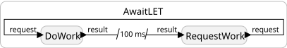
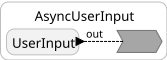

# Async and Await

These examples show how a reaction can wait for a future input or make a blocking C call without preventing other reactions from running or logical time from advancing. A reaction that resumes after the wait can still use values that were on the stack before the wait, so those values do not have to be copied into state variables.

<table>
<tr>
<td>  </td>
<td> <a href="AwaitLET.lf">AwaitLET.lf</a>: <code>RequestWork</code> sends a request and then calls <code>lf_await</code> on the result. The feedback connection has an <code>after</code> delay of 100 ms, so the work has a logical execution time of 100 ms. While the reaction waits, logical time advances and other reactions can execute. A preceding reaction calls <code>lf_await_resume</code> so the waiting reaction resumes at the logical time of the result.</td>
</tr>
<tr>
<td>  </td>
<td> <a href="AsyncUserInput.lf">AsyncUserInput.lf</a>: <code>UserInput</code> calls <code>lf_async</code> to read a line from the keyboard with <code>getline</code>, which blocks until the user types a line. The call is paired with a physical action, so the logical time after it returns is the physical time of the input. A separate reaction prompts for input every five seconds, showing that the blocking read does not stall the rest of the program. A preceding reaction calls <code>lf_async_resume</code> so the waiting reaction resumes at the logical time of that physical action.</td>
</tr>
</table>
